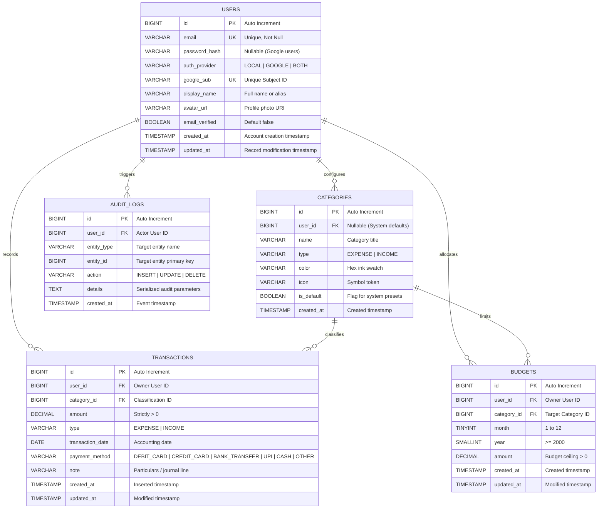

# Ledgerly — Personal & Household Financial Ledger

A production-grade, double-entry inspired personal expense and budget management web application built with a high-performance **Java 17+ Spring Boot** backend, hand-crafted **Spring JdbcTemplate (raw parameterized SQL)** data access layer, **MySQL 8** relational database in **3NF**, and a tactile, editorial **"Paper Ledger"** vanilla web frontend.

---

## 1. Architectural Overview & Highlights

* **Pure SQL Data Access (Zero ORM Bloat)**: Built exclusively using Spring's `JdbcTemplate` with raw SQL queries. Every statement is explicit, transparent, parameterized with `PreparedStatement` to eliminate SQL injection, and optimized for relational database evaluation.
* **Dual Authentication Architecture**: Session-based security supporting both:
  1. Traditional Email + Password authentication salted and hashed via BCrypt (work factor 10).
  2. Google Sign-In using OpenID Connect / OAuth 2.0 Authorization Code grant via `spring-boot-starter-oauth2-client`.
  3. Automatic account linking when a verified Google account matches an existing local email.
* **Strict 3NF Database Design**: 5 relational tables, check constraints, foreign keys with explicit cascade/restrict rules, 2 SQL views, 1 stored procedure, 2 audit triggers, and database-level transactional consistency.
* **Paper Ledger Editorial Aesthetic**: Warm parchment canvas (`#FBF9F4`), deep ink-black typography (*Newsreader* serif paired with *JetBrains Mono* for tabular amounts and *Plus Jakarta Sans* for controls), custom SVG iconography, official Google branding compliance, and native CSS variable dark mode.
* **Zero External Frontend Frameworks**: 100% vanilla HTML5, CSS3, and JavaScript with Chart.js for data visualization and zero npm dependencies.

---

## 2. Tech Stack

| Layer | Technologies & Libraries |
| :--- | :--- |
| **Language & Runtime** | Java 17 / Java 21 / Java 26 (Compiled targeting Java 17 bytecode) |
| **Backend Framework** | Spring Boot 3.3.5, Spring Security 6, Spring MVC |
| **Database Layer** | Spring JdbcTemplate with hand-written parameterized SQL (No JPA / No Hibernate) |
| **Database** | MySQL 8.4 Community Server (InnoDB, utf8mb4) |
| **Authentication** | BCryptPasswordEncoder + Spring Security OAuth 2.0 Client (Google OIDC) |
| **Frontend** | Vanilla HTML5, CSS3 Custom Properties, Vanilla ES6+ JavaScript |
| **Visual Charts** | Chart.js 4.4 (Canvas-based responsive rendering) |
| **Packaging & CI/CD** | Apache Maven 3.9, Multi-stage Dockerfile (Eclipse Temurin JRE base) |
| **Target Cloud Host** | Render Web Services (Docker) + Free Tier Cloud MySQL |

---

## 3. Database Design & Entity-Relationship Diagram (3NF)

The database schema is normalized into **Third Normal Form (3NF)**:
1. **1NF**: All column values are atomic (e.g. monetary amounts stored as `DECIMAL(12,2)`, dates as `DATE`, names and emails as discrete varchar attributes).
2. **2NF**: No partial dependencies; all non-key attributes are fully dependent on the primary key.
3. **3NF**: No transitive dependencies; attributes depend only on the primary keys without intermediary functional dependencies.



### Constraints & Integrity Rules
* **User Authentication Integrity**: `CONSTRAINT chk_user_auth_method CHECK (password_hash IS NOT NULL OR google_sub IS NOT NULL)` ensures a user has at least one valid login credential.
* **Non-Zero Financial Values**: `CHECK (amount > 0)` enforced on both `transactions` and `budgets`.
* **Period Constraints**: `CHECK (month BETWEEN 1 AND 12)` and `CHECK (year >= 2000)`.
* **Unique Period Envelopes**: `UNIQUE (user_id, category_id, month, year)` prevents duplicate budgets for the same category in any calendar period.
* **Foreign Key Rules**:
  * Deleting a user cascades to categories, transactions, and budgets (`ON DELETE CASCADE`).
  * Deleting a category is restricted if transactions reference it (`ON DELETE RESTRICT`), preventing orphan transactions.

---

## 4. Key SQL Queries & Screen Mapping

Below are the primary SQL statements hand-written in Spring `JdbcTemplate` and which screen uses each:

### 1. General Ledger Multi-Filter & Dynamic Search (Transactions Page)
* **Screen**: General Ledger (`/index.html#transactions`)
* **SQL Constructs**: `INNER JOIN`, dynamic `WHERE` with parameterized `PreparedStatement`, `ORDER BY`, `LIMIT / OFFSET` pagination.
```sql
SELECT 
    t.id, t.user_id, t.category_id, 
    c.name AS category_name, c.color AS category_color, c.icon AS category_icon, 
    t.amount, t.type, t.transaction_date, t.payment_method, t.note, t.created_at, t.updated_at
FROM transactions t
JOIN categories c ON t.category_id = c.id
WHERE t.user_id = ?
  AND t.transaction_date >= ?
  AND t.transaction_date <= ?
  AND t.category_id = ?
  AND t.type = ?
  AND (LOWER(t.note) LIKE ? OR LOWER(c.name) LIKE ? OR LOWER(t.payment_method) LIKE ?)
ORDER BY t.transaction_date DESC, t.id DESC
LIMIT ? OFFSET ?;
```

### 2. Monthly Summary Aggregation View (Dashboard KPI Cards)
* **Screen**: Dashboard Top Metrics (`/index.html#dashboard`)
* **SQL Constructs**: SQL View `v_monthly_summary`, `GROUP BY`, Conditional Aggregation with `CASE WHEN` and `COALESCE`.
```sql
CREATE OR REPLACE VIEW v_monthly_summary AS
SELECT
    t.user_id,
    YEAR(t.transaction_date) AS summary_year,
    MONTH(t.transaction_date) AS summary_month,
    COALESCE(SUM(CASE WHEN t.type = 'INCOME' THEN t.amount ELSE 0 END), 0) AS total_income,
    COALESCE(SUM(CASE WHEN t.type = 'EXPENSE' THEN t.amount ELSE 0 END), 0) AS total_expense,
    (COALESCE(SUM(CASE WHEN t.type = 'INCOME' THEN t.amount ELSE 0 END), 0) -
     COALESCE(SUM(CASE WHEN t.type = 'EXPENSE' THEN t.amount ELSE 0 END), 0)) AS net_savings,
    COUNT(t.id) AS transaction_count
FROM transactions t
GROUP BY t.user_id, YEAR(t.transaction_date), MONTH(t.transaction_date);
```

### 3. Category Spending Breakdown View (Dashboard Doughnut Chart)
* **Screen**: Spending by Taxonomy (`/index.html#dashboard`)
* **SQL Constructs**: SQL View `v_category_spending`, `INNER JOIN`, `GROUP BY`, `AVG`, `HAVING` compatibility.
```sql
CREATE OR REPLACE VIEW v_category_spending AS
SELECT
    t.user_id,
    c.id AS category_id,
    c.name AS category_name,
    c.color AS category_color,
    c.icon AS category_icon,
    YEAR(t.transaction_date) AS spending_year,
    MONTH(t.transaction_date) AS spending_month,
    COALESCE(SUM(t.amount), 0) AS total_spent,
    COUNT(t.id) AS transaction_count,
    ROUND(AVG(t.amount), 2) AS average_amount
FROM transactions t
JOIN categories c ON t.category_id = c.id
WHERE t.type = 'EXPENSE'
GROUP BY t.user_id, c.id, c.name, c.color, c.icon, YEAR(t.transaction_date), MONTH(t.transaction_date);
```

### 4. Stored Procedure: Budget Envelope Calculation
* **Screen**: Budget Envelopes (`/index.html#budgets`) and Dashboard Alert Indicators
* **SQL Constructs**: Stored Procedure `sp_calculate_budget_usage`, `LEFT JOIN` on an aggregated Subquery with `GROUP BY`, calculated percentage and conditional risk status flags (`SAFE`, `WARNING`, `EXCEEDED`).
```sql
CREATE PROCEDURE sp_calculate_budget_usage(
    IN p_user_id BIGINT,
    IN p_year INT,
    IN p_month INT
)
BEGIN
    SELECT
        b.id AS budget_id,
        b.category_id,
        c.name AS category_name,
        c.color AS category_color,
        c.icon AS category_icon,
        b.amount AS budget_amount,
        COALESCE(spent.total_spent, 0) AS actual_spent,
        (b.amount - COALESCE(spent.total_spent, 0)) AS remaining_amount,
        ROUND((COALESCE(spent.total_spent, 0) / b.amount) * 100, 2) AS percentage_used,
        CASE
            WHEN COALESCE(spent.total_spent, 0) > b.amount THEN 'EXCEEDED'
            WHEN COALESCE(spent.total_spent, 0) >= (b.amount * 0.85) THEN 'WARNING'
            ELSE 'SAFE'
        END AS budget_status
    FROM budgets b
    JOIN categories c ON b.category_id = c.id
    LEFT JOIN (
        SELECT category_id, SUM(amount) AS total_spent
        FROM transactions
        WHERE user_id = p_user_id
          AND type = 'EXPENSE'
          AND YEAR(transaction_date) = p_year
          AND MONTH(transaction_date) = p_month
        GROUP BY category_id
    ) spent ON b.category_id = spent.category_id
    WHERE b.user_id = p_user_id
      AND b.year = p_year
      AND b.month = p_month
    ORDER BY percentage_used DESC;
END;
```

### 5. Database Triggers (Transaction Audit Logging)
* **Screen**: Database Audit Trail (`audit_logs` table)
* **SQL Constructs**: `AFTER INSERT` and `AFTER DELETE` Triggers recording state changes.
```sql
CREATE TRIGGER trg_after_transaction_insert_audit
AFTER INSERT ON transactions
FOR EACH ROW
BEGIN
    INSERT INTO audit_logs (user_id, entity_type, entity_id, action, details)
    VALUES (
        NEW.user_id,
        'TRANSACTION',
        NEW.id,
        'INSERT',
        CONCAT('Type: ', NEW.type, ', Amount: ', NEW.amount, ', Date: ', NEW.transaction_date)
    );
END;
```

---

## 5. Google OAuth 2.0 / OpenID Connect Setup Guide

Follow these exact steps in the Google Cloud Console to enable "Continue with Google" sign-in:

### Step 1: Create a Google Cloud Project
1. Navigate to the [Google Cloud Console](https://console.cloud.google.com/).
2. Click the project dropdown at the top of the console and click **New Project**.
3. Set the Project Name to `Ledgerly-Expense-Tracker` and click **Create**.

### Step 2: Configure the OAuth Consent Screen
1. In the left navigation menu, go to **APIs & Services** &rarr; **OAuth consent screen**.
2. Select **External** user type and click **Create**.
3. Fill in the App Information:
   * **App name**: `Ledgerly`
   * **User support email**: Select your Google email address.
   * **Developer contact email**: Enter your email address.
4. Click **Save and Continue**.
5. Under **Scopes**, click **Add or Remove Scopes**, select:
   * `.../auth/userinfo.email`
   * `.../auth/userinfo.profile`
   * `openid`
6. Click **Update** &rarr; **Save and Continue**.
7. Under **Test Users**, click **+ ADD USERS**:
   * **IMPORTANT**: While your app is in "Testing" mode, Google rejects any user not explicitly listed here. Add your personal Google account and your evaluators' Google email addresses.
8. Click **Save and Continue**.

### Step 3: Create OAuth 2.0 Web Client Credentials
1. In the left navigation menu, click **Credentials** &rarr; **+ CREATE CREDENTIALS** &rarr; **OAuth client ID**.
2. In the **Application type** dropdown, select **Web application**.
3. Name it `Ledgerly Web Client`.
4. Under **Authorized redirect URIs**, click **+ ADD URI** and add BOTH of the following URIs:
   * Local development: `http://localhost:8080/login/oauth2/code/google`
   * Deployed live app: `https://<your-deployed-render-subdomain>.onrender.com/login/oauth2/code/google`
5. Click **Create**.
6. A dialog will pop up showing your **Client ID** and **Client Secret**. Copy both values.

### Step 4: Configure Environment Variables
Set the following environment variables locally or in your deployment dashboard:
```env
GOOGLE_CLIENT_ID=your-client-id.apps.googleusercontent.com
GOOGLE_CLIENT_SECRET=your-client-secret
```

---

## 6. Environment Variables Reference

| Variable Name | Default Value (Local) | Purpose |
| :--- | :--- | :--- |
| `PORT` | `8080` | Port on which the Spring Boot web server listens |
| `DB_HOST` | `localhost` | MySQL host address |
| `DB_PORT` | `3306` | MySQL port |
| `DB_NAME` | `expense_tracker` | Database schema name |
| `DB_USER` | `root` | Database username |
| `DB_PASSWORD` | `""` | Database password |
| `SPRING_DATASOURCE_URL` | *(Derived from DB_HOST/DB_NAME)* | Direct JDBC connection string |
| `SPRING_DATASOURCE_USERNAME`| *(Derived from DB_USER)* | Direct DB username override |
| `SPRING_DATASOURCE_PASSWORD`| *(Derived from DB_PASSWORD)* | Direct DB password override |
| `GOOGLE_CLIENT_ID` | `not-set` | Google OAuth 2.0 Web Client ID |
| `GOOGLE_CLIENT_SECRET` | `not-set` | Google OAuth 2.0 Web Client Secret |
| `SQL_INIT_MODE` | `never` | Database initialization mode (`never` or `always`) |

---

## 7. How to Run Locally

### Prerequisites
1. **Java Development Kit**: JDK 17 or later installed.
2. **Apache Maven**: Version 3.8+ installed.
3. **MySQL Server**: MySQL 8.x running on port `3306`.

### Step-by-Step Setup
1. **Clone the repository**:
   ```bash
   git clone <repo-url>
   cd "expense tracker"
   ```

2. **Create the MySQL Database**:
   In your MySQL terminal or GUI client (Workbench):
   ```sql
   CREATE DATABASE IF NOT EXISTS expense_tracker CHARACTER SET utf8mb4 COLLATE utf8mb4_unicode_ci;
   ```

3. **Configure Environment Variables**:
   Copy the example file and update your credentials:
   ```bash
   cp .env.example .env
   ```
   Or set environment variables in your PowerShell terminal:
   ```powershell
   $env:DB_PASSWORD = "your_mysql_password"
   $env:GOOGLE_CLIENT_ID = "your_google_client_id"
   $env:GOOGLE_CLIENT_SECRET = "your_google_client_secret"
   ```

4. **Build and Run the Application**:
   ```powershell
   mvn spring-boot:run
   ```
   *Note: On first startup, `DatabaseConfig` will automatically detect the database, create all tables, views, stored procedure, triggers, and seed the initial baseline data!*

5. **Access the Application**:
   Open your browser and navigate to:
   [http://localhost:8080](http://localhost:8080)

   * **Default Seed Account**:
     * **Email**: `elena.vance@ledgerly.internal`
     * **Password**: `Ledger2026!`
   * Or click **Continue with Google** to sign in directly with your Google account!

---

## 8. Deployment Guide (Free Tier)

### Recommended Architecture:
* **Web Service**: [Render](https://render.com) (Free Tier Web Service running Docker).
* **Database**: Free Managed MySQL (e.g. [Aiven](https://aiven.io) Free MySQL or [TiDB Cloud](https://tidbcloud.com) Serverless MySQL).
  *(Note: Free web instances on Render spin down after 15 minutes of inactivity; allow ~40 seconds for the first request to wake up the service).*

### Deployment Steps on Render:
1. Push your repository to **GitHub**.
2. Sign in to [Render Dashboard](https://dashboard.render.com/) and click **New +** &rarr; **Web Service**.
3. Connect your GitHub repository.
4. Set the runtime environment to **Docker**.
5. Under **Environment Variables**, add:
   * `SPRING_DATASOURCE_URL`: `jdbc:mysql://<cloud-db-host>:<port>/<dbname>?useSSL=true&allowPublicKeyRetrieval=true&serverTimezone=UTC`
   * `SPRING_DATASOURCE_USERNAME`: `<cloud-db-username>`
   * `SPRING_DATASOURCE_PASSWORD`: `<cloud-db-password>`
   * `GOOGLE_CLIENT_ID`: Your Google OAuth Client ID
   * `GOOGLE_CLIENT_SECRET`: Your Google OAuth Client Secret
   * `PORT`: `8080` (Render sets this dynamically, but 8080 is default)
6. Click **Create Web Service**.
7. Once deployed, copy your Render service URL (e.g., `https://ledgerly-app.onrender.com`).
8. Return to **Google Cloud Console** &rarr; **Credentials** &rarr; your OAuth client, and add the redirect URI:
   `https://ledgerly-app.onrender.com/login/oauth2/code/google`
9. Visit the live URL and test end-to-end!

---

## 9. DBMS & Java Viva Notes

### 1. Why `JdbcTemplate` instead of JPA / Hibernate?
* **Full Transparency**: Hibernate auto-generates queries (often generating sub-optimal `N+1` select queries or cartesian product joins). With `JdbcTemplate`, every SQL query is written by hand, predictable, easily analyzed using `EXPLAIN`, and visible in viva discussions.
* **Direct PreparedStatement Caching**: Eliminates the overhead of entity dirty-checking and state proxying while ensuring strict PreparedStatement parameterization to prevent SQL injection.

### 2. How is 3NF Achieved?
* The tables isolate independent business entities: `users`, `categories`, `transactions`, `budgets`.
* Categorization is decoupled so renaming a category does not duplicate data across millions of transaction rows.
* Composite primary/unique keys `(user_id, category_id, month, year)` enforce monthly integrity without redundant flag columns.

### 3. How does Google OAuth account linking work?
1. The user authenticates with Google via the Authorization Code Grant.
2. Google returns the ID token and userinfo payload.
3. The server checks `email_verified == true`.
4. It first performs a fast lookup on `users.google_sub`.
5. If absent, it queries `users.email`. If a local user exists with that email, it updates the record to link `google_sub` and sets `auth_provider = 'BOTH'`, avoiding duplicate user accounts.
6. If neither matches, it auto-registers a new Google user and seeds default starting categories within a single transaction.

### 4. What is the role of the Database Trigger?
* `trg_after_transaction_insert_audit` executes directly inside MySQL at the storage engine level. Even if queries are executed outside the application (e.g. via direct DBA scripts), an immutable audit log is guaranteed.
